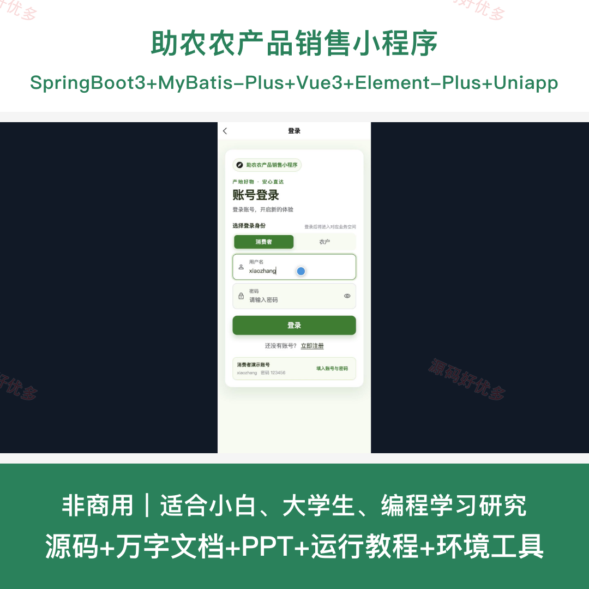
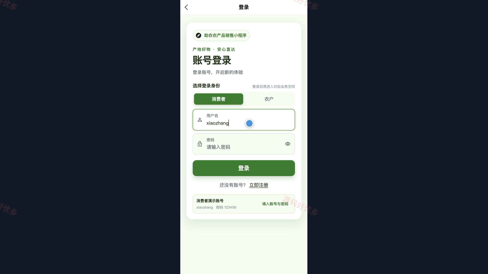
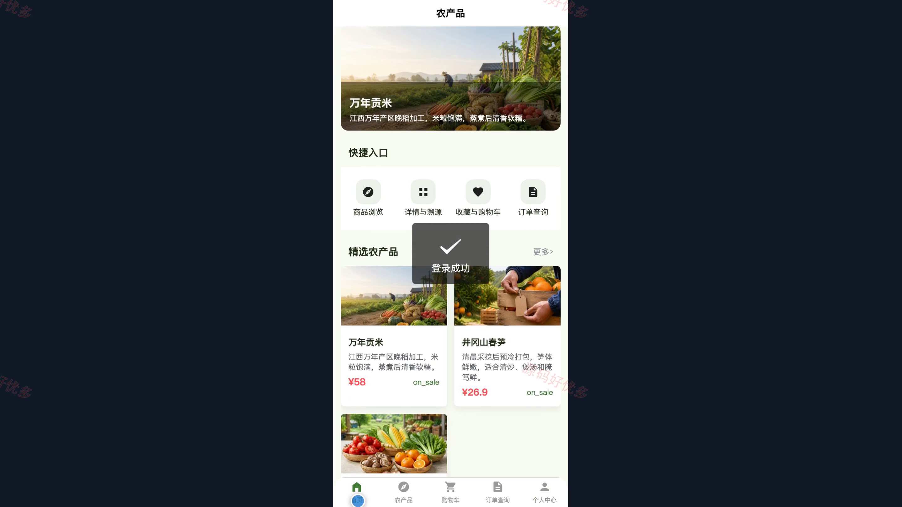
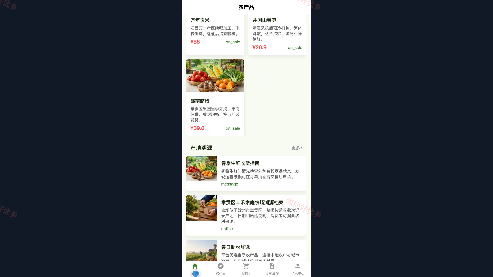
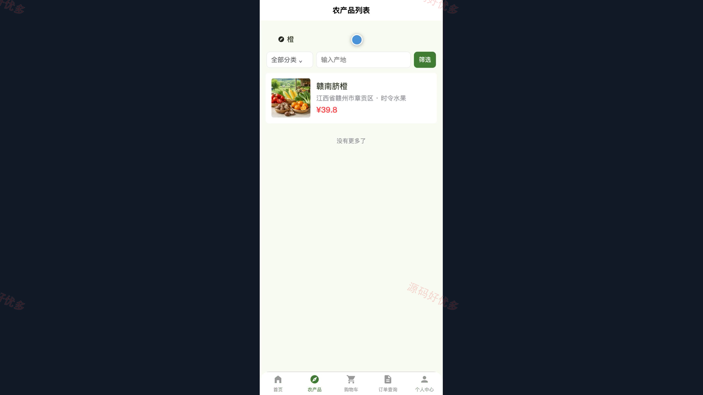
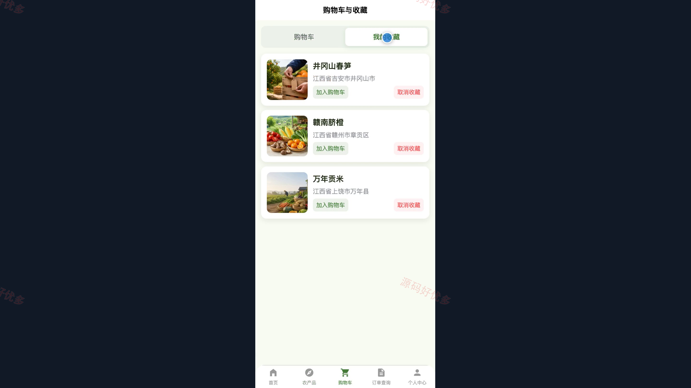
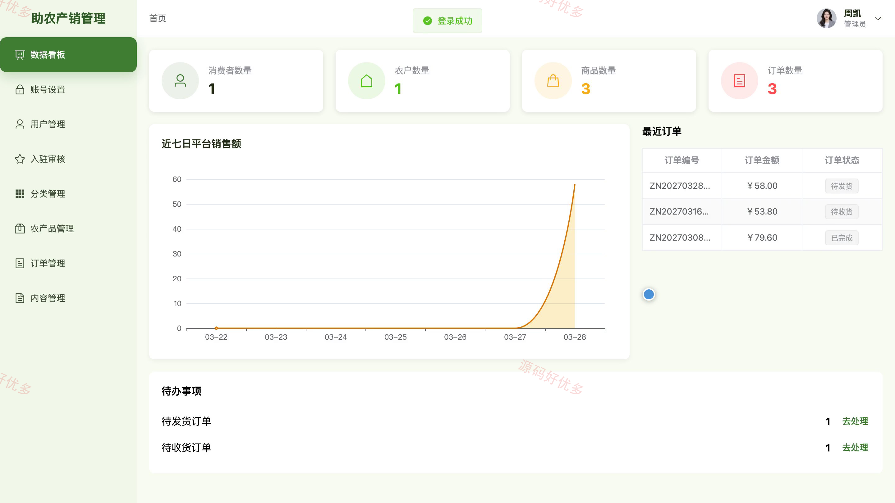
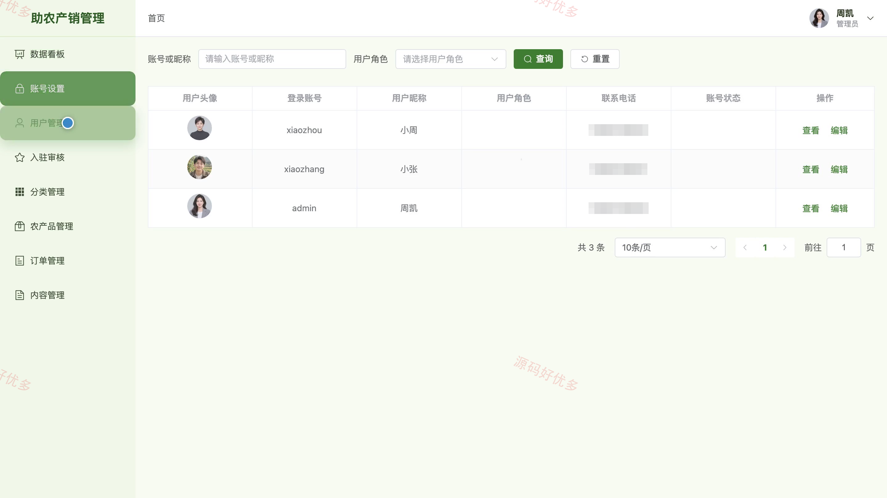
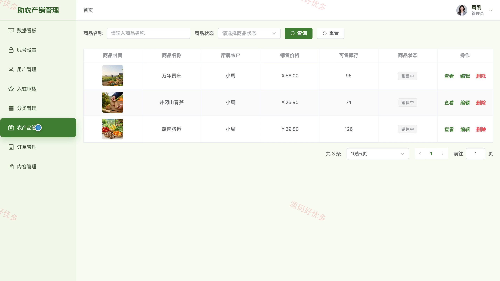

## 源码问题查看主页咨询

### 一、关键词
农产品销售、助农电商、产地直供、农产品溯源、生鲜购物

### 二、作品包含
源码+数据库+万字设计文档+PPT+全套环境和工具资源+本地部署教程

### 三、项目技术
前端技术： Html、Css、Js、Vue3.4、Element-Plus、uniapp
后端技术：Java、SpringBoot3.2.0、MyBatis-Plus

### 四、运行环境要求
开发工具：IDEA/eclipse + VSCODE + HBuilder X + 微信开发者工具

数据库：MySQL5.7+（共16张表）

数据库管理工具：Navicat10以上版本

环境配置软件： JDK17 + Maven3.6

前端Nodejs：16+

浏览器：谷歌浏览器

### 五、项目介绍
项目编号：bs119B

助农农产品销售小程序面向消费者、农户和管理员，提供农产品展示、购物车、下单、售后、评价与产地溯源服务。农户通过工作台维护资质、商品和批次信息并处理订单，管理员负责用户、入驻审核、分类和平台内容管理。

角色：消费者、农户、管理员

消费者功能：小程序登录与注册、农产品分类及详情浏览、购物车与商品收藏、订单提交与订单查询、产地及批次溯源查询、售后申请与进度查看、商品评价与个人资料维护。

农户功能：后台登录与数据看板、农户资质维护、农产品信息管理、批次溯源管理、订单与发货管理、售后处理、评价回复与分类管理。

管理员功能：后台登录与数据看板、用户管理、农户入驻审核、农产品与分类管理、订单监管、平台内容管理、账号设置。

### 六、运行截图

